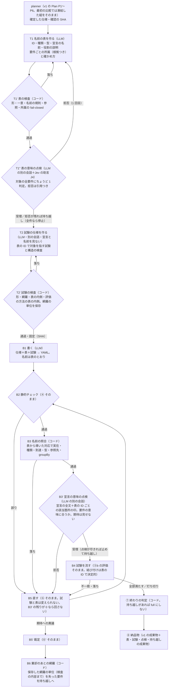

# 07：アーキテクチャ v1.1α（planner → test planner → builder）

> 状態：**v3・所有者が承認**（2026-10-16。所有者の提案「比較用に 3 段の新しい経路を v1 と並べて足す」（[#502](https://github.com/Kewton/Musunest/issues/502)）を設計にし、実装に関与しないレビュー 4 回（1 回目 指摘 19・2 回目 新しい指摘 8 と前回の残り 9・3 回目 新しい指摘 5 と前回の残り 6・4 回目 新しい指摘 2 と前回の残り 1）を反映した。**§8 の 20 点は所有者がすべて推奨どおりに決めた**（2026-10-16。#502 のコメント）。直した点の要約は付録 A）。
> 正本との関係：v1（Plan P1〜P6 → Build ②〜⑧）は [`02-architecture.md`](./02-architecture.md)・[`04-plan-agent.md`](./04-plan-agent.md) のまま **main `2cd1586f856fb1cdecf75ef035826cbffe539e69`（`408b202` に #501 を重ねた版）で凍結し、比較元**にする。v1.1α は同じ工場（`packages/factory`）の中の**別の経路**であり、3 つ目の工場ではない（`CLAUDE.md`「工場は 2 つ・契約は 1 つ」）。評価の決まりは [`methodology/01-eval-sets.md`](./methodology/01-eval-sets.md)、判定の口は [`05-judge-model.md`](./05-judge-model.md)、停止の台帳は [`methodology/ledger/failure-modes.md`](./methodology/ledger/failure-modes.md)。コードの行は main `2cd1586`。
> 計測の出典：**Build 評価の基準**（2026-10-16。main `408b202`・凍結した組 v1（Plan の確定した仕様 10 P を規則で凍結したもの。#499）・10 P × 3 本・effort high・締切 20 分・予算 0.30 USD・並列 3・採点 v5。結果と直し方の決定は [#491](https://github.com/Kewton/Musunest/issues/491) の 2026-10-16 のコメント）と、**Plan 評価の基準**（同日・30 本）。#501 を重ねたあとの少数の診断（10 本）は基準の代わりにしない。本文の秒と件数は記録の実測、USD は記録のトークンに単価を掛けた**見積もり**。証跡を公開する置き場所は未定（§9）。
> 背景：Build 評価の基準は採点 PASS 8/30・工場の `none` 21。停止の原因（C1〜C9。#491）の多くは「設計（②）・試験（②'）・対応表（⑤a）が、同じ名前の対応を別々に推測し、作り直しの輪に入る」ことから来る。v1.1α は**名前を test planner で 1 度だけ固定し、builder はその名前どおりに書く**ことで、この推測を無くす。ただし名前の固定は**事後の付け替えを防ぐ**だけで、**要件に対する意味の点検は、表（T1''）と宣言（B3'）の両方に別に要る**（§1.1）。

## 0. 一言でいうと

**planner（要件の分解）→ test planner（名前の表・表の意味の点検・試験の仕様を固定）→ builder（その名前どおりに YAML を書き、宣言の意味の点検と試験に合格するまで直す）。** 利用者の確認は planner だけに残し、表と試験は利用者に見せない。合否は v1 と同じコード（静的チェック・固定した試験・終わりの判定）が決め、同じ門（bundle-publish）を通す。**最初の比較は planner を v1 と共有し、凍結した組 v1 を v1 の Build と v1.1α の test planner＋builder の両方に入れて、Build 評価で比べる。** この比較で測れるのは「test planner＋builder の合計」であり、3 つの能力の単独の値ではない（§4）。

## 1. 段

| 段 | 誰が | 入力 | 出力 | 検査（コード） | やり直し | 止まり方 | 記録 |
|---|---|---|---|---|---|---|---|
| planner | v1 の Plan | 原文・答え | 確定した仕様（確認の SHA） | `checkConfirmedPlan` | v1 のまま | v1 のまま | 最初の比較では流さず、凍結した組の包みを `--plan-file` で渡す |
| **T1** 名前の表 | LLM（構造化出力） | 確定した仕様・文書（契約・語彙の意味・台帳） | 名前の表（§2.1。行＝ID・種類・型・宣言の名前・**役割の説明と出典**）、要件ごとの所属（根拠つき）、確かめ方 | 形／ID の一意／名前の規則（`NAME_PATTERN`・`RESERVED_NAMES`）と**名前空間ごとの一意**（§2.1）／参照（entity・groupBy・options・refEntity）／**所属の fail-closed**（fixed-test・structural の要件は種類の合う所属 1 件以上、checks ごとに合う種類）／`unresolved` には理由と制約 ID／要件 ID は応答に書かせず一覧の順でコードが付け、行に添えた要件の文の写しと照合する（D10） | 2 回（前回の候補を raw で渡す） | 2 回で落ちれば `name-table/unmet`（早期停止） | 断った候補を #501 の作法で診断に。表の SHA |
| **T1''** 表の意味の点検 | **LLM（別の会話）**＋**Jev の助言（J4。§6）** | 要件の文と引用・表の行（**名前の欄は見せない**。役割の説明・種類・型は見せる）・所属・確かめ方 | **対象の全要件（T1 の `unresolved` を除く）にちょうど 1 判定**：受理／拒否（種類：不要な所属・欠けた対象・弱い確かめ方。**引用つき**） | **完全性**（欠落・重複・未知の要件 ID は形の落ち）／拒否の形（有限の種類・引用が確定した仕様か要件の文にコードで見つかる）／結果を**表の SHA に結ぶ** | 形の落ちは 2 回。拒否は**データで** T1 の 2 回目に渡す（T1 の回数に含める） | 完全な結果が得られなければ `semantic-check/malformed` で止める（点検していない状態で先へ進まない）。T1 の 2 回目でも拒否が残る要件は**持ち越し（unresolved）**にして進む（full 不可。§1.1）。残る要件が 0 なら T2 を呼ばず停止（D15） | `semantic-check.json`（表の SHA・対象の集合・判定・引用・J4 の値。§1.4） |
| **T2** 試験の仕様 | LLM（**別の会話**。宣言も名前も見ない） | 確定した仕様・表（名前の欄を除く）・所属・確かめ方・文書。**持ち越しの要件は一覧と所属から除く**（§1.2） | 試験の組（`FixedTest` の形。対象は表の `id`）、要件ごとの種類の独立の分類、試験ごとの**観測する性質**（`observes`。§2.3） | v1 の ②' の検査（除いた一覧で呼ぶ。形・網羅・ID の内側・所属の内側・options・groupBy・期待の型・構造の検査）＋評価の方法の表（`02` §1.3）に（対象の種類・操作・`observes`）で照合し**未対応の組は作れば落ち**／固定時に**網羅の単位**（要件 × 対象 × 性質 × 検査の内容。§1.3）を保存 | 2 回（前回の試験＋指示。#439 と同じ） | 2 回で落ちれば `test-spec/unmet` | 試験の組の SHA・網羅の単位。断った候補を診断に |
| **B1** 書く | LLM | 確定した仕様・表（名前を含む。持ち越しで除いた行も見せる）・固定した試験・文書 | YAML | 大きさの上限（③ と同じ）。**対応の提出（mappings）は無い**。表に無い要素の追加は許すが、コードが一覧にして B3' に渡す（D4） | 形 2 回 | ③ と同じ | 表・試験・宣言の SHA を検証の結果に |
| B2 静的チェック | コード | YAML | 誤りコード | ④ そのまま | — | — | — |
| **B3** 名前の照合 | **コード** | 宣言・表・所属 | 要件ごとの場所（表から導く）と落ち | v1 の `checkRoleMappings` を表から導いた恒等の対応で呼ぶ。**効くのは 2.（実在・種類・所属 entity・画面からの到達）と options の順・enum の groupBy**。1.（対応の提出漏れ）と 3.（所属の場所が対応表の内側）は構成上つねに通る＝**自己照合であり点検ではない**。足す検査：項目の型・参照先・**月の groupBy（集計元 entity・項目・month の組）**（§2.2）。**⑤a の LLM に対応を提出させる輪は呼ばない**。持ち越しの要件と、その要件だけが所属させる行は対象から外す（共有する行は保つ。§1.2） | — | 落ちは B5 へ（builder が直せる種類。§1.2） | 版ごとの行（#417） |
| **B3'** 宣言の意味の点検 | **LLM（別の会話）** | 要件の文と引用（正本は確定した仕様。#334）・所属の行（`role`・種類・型・名前）・**宣言の全文**（v1 の ⑤a と同じ範囲。`stages/correspondence.ts:1047`）＋**表の `id` ごとにコードが引き当てた該当箇所の印**（要素の種類・名前・位置。項目の定義・計算の式と groupBy・操作の set と when・画面の show と highlight。「どこを見るか」を示すだけで点検の範囲を狭めない）・表に無い追加の要素の一覧（名前・種類・位置。定義は全文にある）。**試験・期待・合否は見せない** | 残る要件ごとにちょうど 1 判定：受理／拒否（種類：式・条件・表示・既定値が要件と食い違う／**参照する補助の定義が要件と食い違う**／必要な振る舞いが所属の外にある／該当箇所が空。**引用つき**）。該当箇所か参照先（式が参照する計算・項目、画面が指す項目）をコードが引き当てられない要件は**受理せず持ち越し** | 完全性（T1'' と同じ）／引用がコードで見つかる／結果を**宣言の SHA に結ぶ** | 拒否は **B5 へ**（意味の落ちとしてデータで渡す。表と試験は変えない）。B2・B3 を通った版ごとに掛け直す（点検を消費するのはこの版だけ）。上限 `declChecks`＝6（v1 の `correspondenceChecks` と同じ数。`limits.ts:49`）。**B5 を回す前に残りの回数を確かめ、0 なら次の版を作らず止める**（D16）。古い版の受理を新しい SHA に使わない | 点検が尽きた（`decl-check/limit`。partial の理由）か停滞したあとに残った拒否・不一致は**持ち越し・未解決**（full 不可。v1 は点検が尽きると評価を打ち切る。`run.ts:1014`）。完全な結果が得られなければ `decl-check/malformed` で止める。枯渇・形の失敗・意味の拒否は別に集計 | `decl-check.json`（宣言の SHA ごとの判定・引用。§1.4） |
| B4 試験を流す | コード | 宣言・試験・表 | 不一致・未解決・構造の検査 | **結び付けは表の `id` →（種類・entity の名前・名前）で決定的。試験 ID で引き、並びでは引かない**（D11）。評価は ⑤b の `runTests` のまま | — | — | — |
| B5 直す | LLM（道具付き） | ⑥ と同じ＋B3' の拒否 | 直した YAML・異議 | ⑥ そのまま。試験と表は変えられない・名前を付け替えない。**道具（試験の実行・対応表の確認）と版の再検査は、評価口から v1.1α の結び付けと B3 を使う**（全部の版で同じ結び付け。§3・D11） | 6 往復・停滞の検知（v1 の値）。**B3' の残りの点検が 0 なら回さず止める**（D16） | ⑥ と同じ | — |
| B5' 裁定 | LLM（別の会話） | ⑥' と同じ（正本は確定した仕様。#334） | 維持／棄却／裁定不能／Plan へ戻す | ⑥' そのまま | — | Plan へ戻すは v1 と同じ停止（終了コード 3）。別に数える（D6） | — |
| **B6** 棄却のあとの網羅 | **コード** | 残った試験・固定時の網羅の単位・表 | 要件ごとの網羅の落ち → 持ち越し | T2' の網羅の検査と**保存した網羅の単位（要件 × 対象 × 性質 × 検査の内容。固定時と同じ鍵）**を、棄却で外したあとの組に掛け直す（§1.3） | — | 止めない。単位を失った要件は持ち越し（full 不可） | 持ち越しの要件と失った単位 |
| ⑦・⑧ | コード | — | `full`／`partial`／`none`・納品物 | `decideOutcome` そのまま。持ち越し（4 つの出どころ。§1.2）は `carriedOver` に載せて unresolved に数える | — | — | v1 の成果物＋v1.1α の成果物（§1.4）。`prompt_version` を `v1.1a` |

### 1.1 意味の独立の点検（名前の固定だけでは足りない）

- 名前の固定が防ぐのは「③ が ② の名前を別のものに付け替える」「⑤b が別の要素へ結び付く」こと。意味の抜けは 2 か所で起きる。**表で**：T1 が要件に合わない対象を所属させた・必要な対象を表に入れなかった・決まりのある要件を弱い構造の検査に落とした。**宣言で**：表が正しくても builder が誤った式・条件・表示・既定値を書いた・必要な振る舞いを表に無い要素へ移した。名前・型・到達の照合と有限の試験は、どちらも全部は捕まえない。表から対応表を導いて所属と照らすのは自己照合で、点検にならない（B3 の 1.・3.）。
- **表の点検（T1''）**：LLM の別の会話が要件ごとに 3 つを見る：所属の各行はこの要件に必要か／要件を満たすのに必要な対象が表に無いか／確かめ方の種類と checks は要件の決まりを確かめられるか。拒否には**確定した仕様か要件の文の引用**を要し、コードが見つけられない引用の拒否は形の落ちにする（追認も捏造も通さない）。拒否は T1 の 2 回目にデータで渡し、残った拒否は**要件を持ち越し（unresolved）**にして B 側へ進む。
- **宣言の点検（B3'）**：v1 の ⑤a は**宣言の全文**を正本に照らし、期待と合否を見せずに独立に点検していた（`stages/correspondence.ts` の規則 R-corr-07・R-corr-09。全文は `:1047` で渡す。[`06-cost-plan.md`](./06-cost-plan.md) §2）。v1.1α は**この性質を残す**：B3' にも宣言の全文を渡し、表の `id` ごとにコードが引き当てた該当箇所（`bind-by-id`）は**印として添える**だけで、点検の文脈を狭めない。狭めると、所属する計算の定義が同じでも参照する補助の計算の式だけが誤る場合を見逃す（アプリ全体の計算は別の全体の計算を参照できる。`appspec-schema/src/spec.ts:359`）。名前は表で固定済みなので対応を提出させる輪は作らず、要件ごとに「要件の意味に合うか」だけを別の会話で判定する。該当箇所か参照先をコードが引き当てられない要件は受理せず持ち越す。拒否は B5 に回し（builder が直せる。表と試験は不変）、B2・B3 を通った版ごとに掛け直す。点検が尽きるか停滞したあとに残った拒否は持ち越し（D16）。**点検を減らす案（最終版だけ・置かない）と文脈を狭める案（該当箇所＋参照先の閉包だけを見せる）は保証の変更であり、既定にしない**（D13）。
- **完全性**（T1''・B3' とも）：対象の全要件にちょうど 1 判定。欠落・重複・未知の要件 ID は形の落ちで、形の直し 2 回で完全な結果が得られなければ段を止める（点検していない状態で先へ進まない）。結果は表の SHA（T1''）・宣言の SHA（B3'）に結び、SHA の合う完全な結果だけを持ち越しの集合の入力にする（§1.2）。
- **持ち越しが 1 件でもあれば full にならない**（#491 の決定 3「拒否を最後まで運ぶ」を新しい経路で継ぐ形）。**J4（Jev の Noul。§6）は助言であり、この保証に数えない。** 印は T1 の 2 回目の入力と記録にだけ効く。
- 負例（API 不要の試験で必須）。表の点検：誤った所属（別の entity の同名の項目）・欠けた対象（要件が求める集計が表に無い）・弱い checks（決まりのある要件を `view-shows` だけで確かめる）。宣言の点検：**宣言だけを変える反例**（表と試験は同じ。名前・型・到達が合い有限の試験が全部通るが、操作の when が要件より緩い宣言）・**振る舞いが追加の要素へ移る反例**（所属の計算が定数で、本当の計算は表に無い要素にある）・**補助の定義だけを変える反例**（所属する計算の式は同じで、参照する補助の計算の式だけが誤る。該当箇所だけを見せる点検では見逃し、全文を見せる点検で拒否が出ること）。どれも拒否が残れば full が出ないこと、B3' を外すと同じ宣言が full に届くこと（点検が効いている証明）。完全性：判定が 1 件欠けた応答・重複した応答を受理せず、拒否の欠落で full が出ないこと。
- T2 が T1 に依存する範囲：**所属（どの ID がその要件のものか）と確かめ方の種類**は T1 のものを使う。種類（ruled／existence-only）は独立に分類し直し、食い違いは J2 で裁く（v1 と同じ）。試験の中身（入力・期待）は T2 が要件の文と役割の説明から作る。T1 と T1''、B1 と B3' が同じ誤解を持てば抜ける（`02` §1.2 R-2。§5 N3）。

### 1.2 持ち越しの集合と除く範囲

- 持ち越し（unresolved）の出どころは 4 つ：T1 の `unresolved`（理由と制約 ID）／T1'' の拒否が残った要件／B3' の点検が尽きるか停滞したあとに残った拒否（文脈を引き当てられない要件を含む）／B6 の網羅の落ち。集合は**採用した表・表の SHA が一致する完全な点検結果・試験・B6 の結果からコードが導く**。SHA の合わない結果・不完全な結果は「点検していない」として段を止め、持ち越しを空にして先へ進む経路を作らない。要件 ID・理由・出どころ・除いた行を `carry-over.json` に残す（§1.4）。⑦ には `UnmetCarryOver.testSuite` に載せて渡す（v1 では常に空。`run.ts:1281`）。
- **除く範囲（D14）**：持ち越しの要件は、T2' の網羅の検査・B3・B3'・B4・B6 の**要件の一覧と所属**から除く。**その要件だけが所属させる行**は、B3 に渡す役割の表と恒等の対応からも除く（`checkRoleMappings` は渡した全部の役割を照合するので、一覧だけを除いても行は残る。`stages/correspondence.ts:817`）。**別の要件も所属させる行（共有する行）は保って検査する。** builder には表の全行を見せる（除いた行を書いてもよいが検査しない）。`checkCorrespondence` は空の場所を落ちにするので、架空の場所で埋めず、除いた一覧で呼ぶ。
- **全件が持ち越し（D15）**：T2' は空の試験の組を断る（`stages/test-suite.ts:378`）。残る要件が 0 なら T2 を呼ばず `carry-over/all-requirements` で止める（工場の判定は `none`。停止の段として別に数える）。**後段（B3' の持ち越し・B6）で残る要件が 0 になった場合も同じく `none` に統一する**：v1.1α の制御が ⑦ の前に「検証した要件が 0」を確かめて止める（⑦ をそのまま通すと静的チェック通過・全件 unresolved は partial になる。`outcome.ts:87`。共有する v1 の ⑦ の判定は変えない）。1 件でも残れば通常どおり進み、持ち越しは partial に留める。
- **持ち越しだけが残った状態では B5 を回さない**（直せるものが無い）。B3 の落ちは builder が直せる種類（名前が無い・種類違い・到達しない・options の順・groupBy の組・型・参照先）と B3' の拒否だけが B5 へ行く。B3' の残りの点検が 0 なら B5 を回さず止める（D16）。表そのものの問題は T1'・T1'' で止めてあり、B3 では出ない前提。同じ落ちが続けば v1 の停滞の検知で止め、残った落ちは未解決に数える（`run.ts:1269` と同じ扱い）。

### 1.3 棄却のあとの網羅

- v1 は棄却した試験を除いて流し、⑦ は残った結果の件数だけを見る（`run.ts:958`・`outcome.ts`）。ある要件の試験が全部棄却されても full に届きうる。v1 の網羅の検査も、要件ごとの種類の集合と check 名の集合しか見ない（`stages/test-suite.ts:447`・`:871`）ので、1 要件の対象 X・Y のうち Y の試験を全部棄却しても、X の正常・異常・境界が残れば通る。
- v1.1α は**最初の比較から** B6 を置く。T2' は固定時に、組が覆う**網羅の単位**を保存する。鍵は**検査の内容まで**含める：ruled の要件は（要件・対象の `id`・正常／異常／境界・操作・`observes`）、structural は（要件・対象の `id`・**正規化した assertion 全体**＝check・expected・refEntity・role）、existence-only は（要件・対象の `id`・正常・操作・`observes`）。check 名だけでは、同じ要件・同じ画面に `view-shows(X)` と `view-shows(Y)` があると 1 つの単位になり、Y だけ棄却しても X が単位を保つ（v1 の網羅の検査は check 名の集合しか見ない。`stages/test-suite.ts:871`。`assertion` は `role`・`refEntity`・`expected` を持つ。`fixed-test.ts:86`）。値の試験も操作と `observes` の違いを潰さない。**固定時と棄却後で同じ鍵を使う**（単位は `coverage.ts` が試験の欄から導き、`checkSuitePlan` の check 名の集合は使わない）。棄却のたびに、T2' の網羅の検査と**保存した全単位**を残った組に掛け直し、単位を 1 つでも失った要件を持ち越しに足す。試験の組の SHA は固定したまま（組は作り直さず、外した ID と失った単位を別に残す）。
- 裁定不能は未解決（v1 と同じ）。Plan へ戻すは停止（終了コード 3）として**別に数える**。負例：全棄却・一部棄却（正常だけ残る）・**X だけ残る（Y の単位を全部失う）**・**同じ画面の `view-shows(X)`・`view-shows(Y)` のうち Y だけを失う**・同じ check を求める別の対象を失う・裁定不能・Plan へ戻す、の 7 つで full が出ない／別に数えられること。

### 1.4 記録と成果物

- v1 の `assembleBundle` の成果物（`design.json` ほか）はそのまま出す。**`design.json` は表を v1 の型へ写したもの**なので型・参照先・月の形・役割の説明・観測する性質・網羅の単位が落ちる（§2.2）。だから v1.1α の成果物を**足す**：`name-table.json`（表・所属・確かめ方・役割の説明・SHA）、`test-spec.json`（試験の組・SHA・`observes`・網羅の単位・棄却した ID・B6 の結果）、`semantic-check.json`（T1''：表の SHA・対象の要件の集合・判定・引用）、`decl-check.json`（B3'：宣言の SHA ごとの判定・引用・該当箇所と参照先の位置・残りの点検の回数）、`carry-over.json`（持ち越しの要件・理由・出どころ・除いた行）、`judge-advice.json`（J4：問いの ID・値・adapter・版・閾値。`05` §8 U-J3）、`verification-v11a.json`（実際に検査した表・試験・宣言の版の SHA）。v1 の `partial_reasons` と追加の記録の読み分けは実装の文書に明記する。
- 足し方：`BundleInput` に任意の `extraArtifacts` を足し、manifest の `files` に載せる（省けば v1 の出力は 1 バイトも変わらない。契約試験で確かめる）。門（bundle-publish）の 5 段は変えない。門は追加のファイルも manifest で照合するが、表と試験の意味や版の一致は検査しない。門に表と試験の SHA の照合を足すのは別の仕事（D2）。
- `summary.json` の `prompt_version` を `v1.1a` にする。判定の呼び出しの数と費用は v1 の `judge` の欄（#359）に載る。

## 2. 契約

### 2.1 名前の表

| 欄 | 中身 | v1 の役割の表（`RoleEntry`）との差 |
|---|---|---|
| `id` | 表の ID（T1 が振る。**全体で一意**。安定な鍵） | `roleId` に当たる |
| `kind` | entity・field・computation・operation・screen | 同じ 5 種（`validation` は段階 2。D3） |
| `entity` | 所属する entity の `id`（entity 自身は null） | 同じ |
| **`name`** | **宣言で使う名前**（`NAME_PATTERN` を満たし予約語でない）。一意の単位は spec-engine の静的チェックの名前空間に合わせる（entity 名は全体、項目名はその entity の中、ほかは種類ごと。§9）。**別の entity の同名は許し、`id` で区別する** | v1 の `name` は呼び名で宣言の名前ではなかった。ここが v1.1α の中心 |
| **`role`**・**`source`** | 要件に結んだ**役割の説明**（1 文。「要件 R3 が数える対象」の形）と出典（要件 ID・引用の位置） | v1 の呼び名が担っていた意味を、名前と分けて持つ |
| `type` | 宣言の欄に 1 対 1 で写せる値。項目は `FieldKind`（文字・数・日付・選択肢・参照 ほか）。計算は 3 つを分けて持つ：**値の型**（`ComputedType`＝`number`／`boolean`／`groups`。`appspec-schema/src/spec.ts:235`）・**範囲**（行ごと＝`entity` を持つ／アプリ全体＝`scope: app`／見出しごと＝`groups` で `entity` も `scope` も持たない）・**種別**（式／集計／精算）。操作は操作の種類（`ACTION_KINDS`）と when の有無、画面は画面の種類（`VIEW_TYPES`）。**B3 の照合先**：値の型は宣言の `type`、範囲は `entity`・`scope` の有無、種別は `expression`・`aggregate`・`settle` の欄の有無、項目は項目の種類の欄（値の一覧は A1 で固定） | v1 に無い（型が無いと C3 を診断できない。`number` と `boolean` の一致は値の型で調べる） |
| `options` | 選択肢のキーの並び（enum の項目だけ） | 同じ |
| `groupBy` | `{ kind: enum, field: id }`／`{ kind: month, field: id }`／null。月は（集計元 entity・項目・month）の組で照合する（§2.2） | v1 は enum の項目の役割 ID か null（月の形を書けない） |
| `refEntity` | 参照の先の `id` | v1 に無い |
| （行の外）`ownership[]` | 要件ごと `{ requirementId, roles: [{ id, basis（stated／dependency）, reason }] }`。項目を所属させたら entity も所属（コードが導き、basis は `dependency`・reason に導いた項目の `id` を残す） | v1 の `RoleOwnership` と同じ根拠を**持つ**（写しで捏造しない）。`shared`・`aliasOf` は持たず、共有は所属の数から**導く**（D9。#491 の決定 2 を新しい経路で変える承認候補）。**複数の `id` が同じ（種類・entity・名前）を指す別名は T1' の一意の検査で落ちる**（v1 の `aliasOf` の形は書けなくなる） |
| （行の外）`verification[]` | 要件ごとの確かめ方（fixed-test／structural＋checks／unresolved＋reason＋constraintIds） | 同じ（`RequirementVerification`） |

- 試験が対象を指す鍵は表の `id`（D1）。`FixedTest.target.roleId` に入れるので型と `checkFixedTest` はそのまま。結び付けは `id` →（種類・entity の名前・名前）で決定的に行い、**試験 ID で引く**（D11）。v1 の `bindTests` は対応表の候補を名前だけで絞るので、同じ要件が別 entity の同名を所有すると `ambiguous` になる（`stages/bind.ts:99`）。これは**使わない**（B4 だけでなく、修復の道具と版の再検査も含めて。§3）。
- M-03（validate の試験が同名の検査にしか結び付かない。台帳）は**残る**：最初の比較の表に `validation` の行が無く、検査の式の場所は項目の名前で探す（v1 と同じ）。段階 2 で `validation` の行を足して `id` で結ぶ（D3）。

### 2.2 v1 の型への写し（純粋な関数）と失われる情報

「v1 の型へ写して既存の処理を呼ぶ」範囲を限定する。写しは **⑤b の評価（`runTests`）・⑥・⑥'・⑦・⑧・⑤a のコードの検査の入力**にだけ使い、**契約の検査は v1.1α 側で表に対して行う**。

| 欄 | 写し先 | 失われるもの・v1.1α 側の検査 |
|---|---|---|
| `id`・`kind`・`entity`・`options` | `RoleEntry.roleId`・`kind`・`entity`・`options` | 無し |
| `name` | `RoleNameMapping { roleId: id, name }`（恒等の対応）と `RoleEntry.name` | `RoleEntry.name` は呼び名の欄なので意味は落ちる（`role` は `name-table.json` に残す） |
| `role`・`source` | 写さない | 成果物にだけ残す |
| `type`・`refEntity` | 写さない | **B3 の追加の検査**（宣言の項目の型・参照先、計算の値の型・範囲・種別が表と一致。§2.1）。構造の検査 `field-type` は試験として別にある |
| `groupBy` enum | `RoleEntry.groupBy = 分ける項目の id` | 無し（`checkGroupByRelation` が `month === false`・分ける項目・`aggregate.entity` を照合する） |
| `groupBy` month | `RoleEntry.groupBy = null` | **v1 の検査が掛からない** → B3 の追加の検査を（集計元 entity・項目・month）の組で行う：宣言の `aggregate.groupBy.month === true`・分ける項目の名前の一致・**`aggregate.entity` が表の集計元 entity の名前に一致**。見出しごとの集計は自身の entity を持たず `aggregate.entity` だけが集計元を示すので、項目名と month だけでは別 entity の同名 date 項目へ向けた宣言を通してしまう（負例を A1 に）。②' の見出しの検査は enum だけ（v1 と同じ） |
| `ownership`（basis・reason） | `RoleOwnership` そのまま（導いた entity の所属も basis `dependency`・reason つきで写す）。`shared` は所属の数から導く | 無し（D9） |
| `verification`・`checks` | `RequirementDesign.verification`・`checks` | 無し |
| 要件ごとの種類（T2 の独立の分類） | `TestSuite.classifications` | 無し（v1 と同じ欄） |
| `observes`（試験が観測する性質） | 写さない（`FixedTest` に欄が無い） | T2' の評価可能性の照合に使う（§2.3）。成果物にだけ残す |
| 網羅の単位 | 写さない | B6 が使う（§1.3）。成果物にだけ残す |
| `vocabulary`・`placement`・`unwritable` | 空の並び | T1 は語彙と置き場所を書かない（名前と型が代わり）。**「書けない」は `unresolved`＋制約 ID で表す**ので、Build 側の申告の仕分け（`stages/unwritable-triage.ts`）は呼ばれない（§9） |
| 持ち越し | `UnmetCarryOver.testSuite` | v1 では空。理由と出どころは `carry-over.json` に |

- 置き場所：最初の比較は `packages/factory/src/v11a/`。依存の向き `factory → appspec-schema, spec-engine` は変えない（`dep-graph.mjs` を触らない）。門（control-plane）は factory に依存できないので、門に表と試験の SHA の照合を足すなら wire の型を appspec-schema へ移す（段階 2。D2）。

### 2.3 試験の仕様

- 形は `FixedTest`・`TestSuite` のまま。`target.roleId`・`referenceData[].target.roleId`・`inputContract`・入力と値の鍵・`assertion.refEntity`・`assertion.role` が表の `id` を指す。
- 検査は ②' の `checkSuitePlan` をそのまま（持ち越しを除いた一覧で呼ぶ。表の ID の内側・所属の内側・options・groupBy・期待の型・構造の検査）に 3 つを足す。(i) **試験ごとに観測する性質 `observes`**（when の判定・値・検査の式・画面の構造・在ること）を持たせ、評価の方法の表（`02` §1.3）と（対象の種類・操作・`observes`）の 3 軸で照合し、未対応の組（操作に set を当てたあとの状態・項目の既定値）は作れば落ち（v1 は作ってから ⑤b で未解決にしていた）。`FixedTest` は observes を持たず（`fixed-test.ts:158`）、⑤b は操作 × action を全部 when の評価に送る（`stages/run-tests.ts:829`）ので、**対象の種類 × 操作の二軸だけでは意味まで判別できない**。observes で表せない性質は B3' の意味の点検に委ねる範囲として明記する。(ii) 持ち越しの要件には試験を求めない。(iii) 網羅の単位を保存する（§1.3）。
- T2 に見せるもの：表の `id`・`kind`・`type`・`entity`・`options`・`groupBy`・`refEntity`・**`role`・`source`**、所属、確かめ方。**`name` は見せない**（宣言に合わせた期待へ寄る口を作らない）。v1 の ②' は役割の表（呼び名を含む）を見ていた（`stages/test-suite.ts` の `buildData`）。v1.1α では呼び名の代わりに `role` を見るので、意味の手がかりは同等（実測前の仮説。§9）。

## 3. 再利用・新規・v1 の最小の変更

| 区分 | 中身 |
|---|---|
| そのまま使う（変えない） | `fixed-test.ts`・`run-tests.ts` の評価（`runTests` の判定）・`static-check.ts`・`correspondence.ts` のコードの検査（`checkCorrespondence`・`checkRoleMappings`）・`arbitrate.ts`・`outcome.ts`・`bundle.ts`（`assembleBundle`）・`budget.ts`・`call.ts`・`prompt.ts`・`judge*.ts`・`openai.ts` の送り方・`plan/*`・`cli-plan.ts`。`test-suite.ts` の `checkSuitePlan`（網羅の部分は B6 でも呼ぶ） |
| 新しく作る（`v11a/`） | `names.ts`（表の型・検査・名前空間の一意）、`convert.ts`（§2.2 の写し）、`bind-by-id.ts`（`id` → 場所。試験 ID で引く対応表と、宣言の該当箇所・参照先の位置の引き当て（B3' の印）。D11）、`name-check.ts`（B3：導いた対応で v1 の検査を呼ぶ＋型・参照先・月の組）、`evaluate.ts`（**評価口**：宣言 → B3 の落ち・結び付け・試験の結果。B4・B5 の道具・版の再検査が同じものを使う）、`carry-over.ts`（§1.2 の集合と除く範囲）、`coverage.ts`（網羅の単位（検査の内容を含む鍵）と B6）、`stages/name-table.ts`（T1）、`stages/semantic-check.ts`（T1''）、`stages/decl-check.ts`（B3'）、`stages/judge-advice.ts`（J4）、`stages/test-spec.ts`（T2）、`stages/write.ts`（B1）、`bundle-v11a.ts`（成果物の追加）、`run.ts`、試験（偽物の LLM・判定・時計。§1.1・§1.3 の負例を含む） |
| v1 に手を入れる**最小の箇所**（すべて追加だけ。既定は不変） | `cli.ts`：`--pipeline v1.1a`（既定 v1。`--plan-file` と組む）／`index.ts`：export／`record.ts`：`STAGE_IDS` に `name-table`・`semantic-check`・`test-spec`・`name-check`・`decl-check`・`coverage`／`limits.ts`：出力の上限の表に新しい段・`declChecks`／`bundle.ts`：`BundleInput.extraArtifacts?`／`run-tests.ts`：`RunTestsInput.bindings?`（**試験 ID で引く対応表**。渡せば `bindTests` を呼ばない）／**`repair.ts`・`tools.ts`：`RepairStepInput`・`RepairToolContext`・版の再検査（`checkDeclarationVersion`）に任意の評価口 `evaluate?`**（渡せば道具の「試験の実行」「対応表の確認」と直しの版の再検査が v1.1α の結び付けと B3 を使う。省けば v1 の `bindTests`・`checkRoleMappings`・`checkCorrespondence` のまま。`stages/repair.ts:331`・`:544`・`stages/tools.ts:196`・`:214`）／`openai.ts`・`schema-envelope.ts`：封筒の差し込み（D12） |
| **v1 の振る舞い・出力・終了コードを変えない** | `--pipeline` を省けば v1 の経路。v1 の要求のバイト列・納品物のファイルの集合と中身・要約・終了コード・**修復の道具の結果**が同じことを契約試験で確かめる（封筒・成果物・結び付け・評価口の追加はすべて任意の引数） |
| 計測・採点の道具（workspace。human-only） | `run-agent.mjs` に `--pipeline`（条件の `params` と署名に入れる。条件の版を上げる）、`score-agent.mjs` の `BUILD_STAGE_IDS` に新しい段（無いと `unknown` に写る）。採点の定義・分母・PASS の判定は変えない |

## 4. 評価

最初の Build 比較で測れるのは **test planner＋builder の合計**。能力ごとの値は正解のデータ（D8）が揃ってから。

| 評価 | 何を測るか | 正解のデータ | 読み方 |
|---|---|---|---|
| **T1 の評価（新）** | 形と網羅：T1'・T1'' の 1 回目の通過率・拒否の種類の分布・`unresolved` の数。意味：**人の正解の表**（要件ごとの所属と確かめ方）との一致（所属の取りこぼし・余計な所属・確かめ方の種類違い） | 正解の表（人）。一致は要件ごとの（対象の種類 × 役割）の対で取り、名前と `id` は照合しない。等価と認める別解は正解の表に併記する（D8） | 一致は要件ごと。拒否の分布は T1'' の効きの指標 |
| **T2 の評価（新）** | 正解の表から T2 だけを流す。**正解通過率**：正しい YAML に当てて通る試験の率（分母＝試験）。**有効な変異の検出率**：要件に反する変異で 1 本以上落ちる率（分母＝有効な変異） | 正しい YAML（人）、要件ごとの確かめ方、**変異ごとの正解の分類**（人） | 変異はコードが作り（比較の反転・validation の削除・options の順・`show` の欠落・`when` の削除）、1 つずつ **静的 NG／要件違反／同値（違反しない）／適用不能** に分類する。静的 NG と同値は分母に入れない。**変異を無条件に不良と数えない**（`show` の省略は全部表示で要件を満たしうる） |
| **builder の評価（新）** | 正解の表と**正解の試験**から B1〜B5 だけを流す。PASS・B3 の落ちの種類・B3' の拒否の種類・B5 の往復 | 正解の表と**正解の試験**：人が書くか、T2 の出力を人が検証して直し、版（SHA）を付けて凍結したもの。**T2 の生成結果をそのまま正解にしない**（T2 の誤りが builder の値に混ざる）。担当は D8 | T1・T2 の誤りを含まない builder の値 |
| **Build 評価（v1 と v1.1α）** | 凍結した組 v1・同じ条件（effort high・締切 20 分・予算 0.30 USD・採点 v5）。**P × 反復の対を起動の前に固定**し、先行順を対ごとに入れ替える（v1 → v1.1α、次の対は v1.1α → v1）。**両群の合計の並列数を 3 に固定**（各群 3 にしない）。各群の dist・文書・採点・判定の構成・凍結した組の指紋を記録（`01` §4）。比較元は main `2cd1586f856fb1cdecf75ef035826cbffe539e69` | 無し（外部の採点 v5） | **原文系の PASS・了承後系・工場の判定を別に並べる。** v1 の基準では原文系 PASS 8/30（すべて工場 `partial`）、了承後系は納品 9 本が UNEVALUATED 7・FAIL 2（変更後を判定する手段が無い間は PASS を観測できない。FAIL の 2 本は失敗の理由も並べる）。**改善は原文系 PASS の対の差（対ごとに ＋1／0／−1）の数と、その平均の区間で読む。** 各群の率に添える Wilson の区間は実行のばらつきの参考で、**対の差の区間の代わりにならない**（`01` §4）。停止段・持ち越しの内訳を併記し、改善の信号であって成績の確定とはしない（追加判断 B）。予定 30 本と段ごとの到達数を分けて報告する |
| 通し評価 | planner を共有するので流さない | — | planner を変える段階（v1.1β）で |

費用と時間（**見積もり**。**1 試行の単価**にそろえる。v1 の段の中央値は 2 呼び出しを含むので 2 で割る：② 334 秒・0.020 USD・2 呼び出し → T1 1 試行 ≈ 167 秒・0.010、②' 234 秒・0.020・2 呼び出し → T2 1 試行 ≈ 117 秒・0.010。T1''・B3' 1 試行 ≈ ⑤a 1 回（61 秒・0.005。全文を渡す点も同じ）、B1 1 試行 ≈ ③（18 秒・0.002。1 呼び出しと仮定）、B5 1 往復 ≈ ⑥（101 秒・0.012）、B5' ≈ ⑥'（10 秒・0.003）、J4 1 回 ≈ 0.001。通信の再試行は下の式にも数値例にも**含めていない**：回数・追加時間・課金は実測で別に記録する）。以下の金額と時間はすべて**シナリオの推計**で、費用の上限ではない。回数ごとの積算：

- 1 本 ＝ T1×n₁ ＋ (T1''＋J4)×m₁ ＋ T1''×f₁ ＋ T2×n₂ ＋ B1×n₃ ＋ B3'×(v＋f₂) ＋ B5×n₅ ＋ B5'×n₆ ＋ LLM の判定×n₇。n₁ は T1 の呼び出し（1〜2。T1' の落ちか T1'' の拒否で 2）、m₁ は T1'' の回数（T1' を通った版の数。1〜2）、f₁・f₂ は T1''・B3' の**形の再試行**（各 0〜2。別に数える）、n₂ は T2（1〜2）、n₃ は B1（1〜2）、v は B2・B3 を通った宣言の版の数（1〜6＝点検の回数）、n₅ は B5 の往復（0〜6。B3' の残りが 0 なら止まる。D16）、n₆ は裁定（0〜n₅）、n₇ は Jev から LLM への落とし先（0〜問数。門で止まれば 0）。
- **完走・最少**（すべて 1 回・修復なし）：**0.033 USD・約 7 分**。**完走・中央値相当**（n₁＝n₂＝2・ほか 1・修復なし。v1 の段の中央値と同じ呼び出し数）：**0.053 USD・約 12 分**。**完走・修復あり**（n₁＝n₂＝m₁＝2・v＝3・n₅＝2・n₆＝1）：**0.096 USD・約 18 分**。**締切を外した仮想の上側**（n₁＝n₂＝n₃＝m₁＝2・f₁＝f₂＝2・v＝6・n₅＝n₆＝6）：**約 0.20 USD・約 33 分**。締切 20 分（両群同じ。D17）の下ではこの本は**締切停止**になり、費用は約 0.12 USD で止まる（費用が時間に比例するという仮定の推計。§5 N6）。**早期停止**：T1 で止まる（`name-table/unmet`。n₁＝m₁＝2）約 0.03 USD・約 8 分、T2 で止まる（`test-spec/unmet`）約 0.05 USD・約 12 分。
- **30 本の見積もり**：全部完走なら **1.6（中央値相当）〜2.9（修復あり）USD**、全部が締切停止なら 3.6 USD。v1 の基準と同じ停止の割合（T1 で 10・T2 で 9・締切 2・完走 9）なら**約 1.9 USD・並列 3 で約 130 分**（v1 の実測は 30 本 1.305 USD・103 分。T1''・B3' の分だけ v1 より増える）。v1 を交互に流し直す分 ＋約 1.3 USD・＋約 105 分（実測の再現を仮定）。**比較全体（v1.1α 30 本＋v1 30 本）の見込みは約 3.2 USD、上側のシナリオで約 4.9 USD、時間は並列 3 の合計で 4〜5 時間**（v1 を過去の実績 1.3 USD に据えた条件つきの推計。予算の上限と未完了時の扱いは D17）。T2 だけの評価は 10 本 × 3 ≈ 0.3〜0.6 USD。採点（score-agent）の費用が v1 の基準の額に含まれるかは未確認（§9）。
- 前提：単価と出力の長さは v1 と同じ、再生成の前回の候補の分だけ入力が増える、キャッシュは D12 の封筒しだい（封筒に載せないと段をまたぐキャッシュが当たらず入力の費用が増える）。精算額と未精算の予約は分けて記録する。

## 5. 今の停止の行き先

「なくす条件」は構造で消える条件、「移る」は別の段に同じ原因が出ること、「回復」は未計測のもの。件数は v1 の基準 30 本（#491）。

| 停止（v1） | 故障の仕組み | v1.1α でなくす条件 | 移る停止 | 未計測の回復 |
|---|---|---|---|---|
| C1 所属の空いた要件に ②' が試験を強いる（8 本。unresolved 7・structural の不備 1） | 契約の矛盾・持ち越し無し | T1' が fixed-test／structural に所属を求め、`unresolved` は試験を求めず持ち越す（§1.2） | — | 持ち越しが partial に留まる率。前置きの要件（#491 決定 5）の確かめ方は T1 しだい（v1 の完走 9 本では fixed-test 5・unresolved 3・structural 1）。`unresolved` にすれば full 不可 |
| C2 ② の作り直しに前回の応答が無い（10 本） | 入力の欠落 | T1・T2 は最初から前回の候補を渡す（#439・#479 と同じ塊） | — | **渡せば通るか**は未計測 |
| C3 見出しの元に options が無い（3 本） | 契約が月の形を書けない | `groupBy` に month（D3）＋B3 の組の検査 | 選択肢の項目に options を書かない揺れ → T1' の落ち | — |
| C4 所属の整合（shared・重なり・参照先・根拠の無い役割。5 本） | LLM に導ける欄を書かせる | `shared` を導く（D9）、entity の所属を導く、重なりは集合 | 「どの要件にも所属しない行」「根拠の無い所属」「同じ場所を指す別名」は T1' の落ち | — |
| C5 要件 ID の写し違い（2 本） | 自由文字列 | 応答に書かせず一覧の順で付け、行に添えた要件の文の写し（一意になる長さ）で入れ替えを検知（D10） | 写しも位置も合うが意味を取り違えた要件は T1''・B3' と試験に移る | — |
| C6 試験の対象が所属に無い（4 本） | 揺れ・②' から ② へ戻す口が無い | — | T2' の同じ検査（作り直し 1 回。T1 へは戻さない） | — |
| C7 ⑤a の作り直しの輪・締切（P10 2 本） | ⑤a に「合わない」を返す欄が無い | ⑤a の LLM に対応を提出させる輪は無い。要件→場所は表から導く | **意味の拒否は T1''（表）と B3'（宣言）へ移る**（T1'' の拒否 → T1 の作り直し → 持ち越し。B3' の拒否 → B5 → 点検が尽きれば持ち越し）。P10 は ②＋②' の長さ（3 本で 679〜776 秒。③ を含まない）が T1＋T1''＋T2 に残り、締切 20 分に近い | — |
| C8 断った候補が記録に無い | 記録 | 最初から入れる（#501 の口） | — | — |
| C9 選択肢の外の値（副次 2 本） | 規則 | — | 同じ検査 | — |
| ③ の対応の出し直し・⑤b の `no-mapping`／`outside-table`／`ambiguous` | 対応の推測 | 対応は恒等、結び付けは `id`（修復の道具と版の再検査も同じ。D11） | — | — |
| ⑤b の未解決（評価の方法の表で未対応の組） | 受け持ち | T2' で `observes` を含めて作らせない | 要件を構造の確認に寄せられるかは T1 の確かめ方しだい（寄せられなければ持ち越し → 同じ partial）。observes で表せない性質は B3' に委ねる | — |
| Plan 評価の停止 | — | 変わらない（planner 共有） | — | — |
| **新しい危険** | — | — | N1 B1 が表の名前を守らない → B3 → B5。N2 表に無い要素の追加（D4。B3' に一覧を渡す）。N3 **共通の意味抜け**（T1 と T1''、B1 と B3' が同じ誤解。`02` §1.2 R-2）。N4 位置と写しが合う要件の取り違え（C5 の残り）。N5 持ち越しの修復不能（表を変えられない builder が B3 の落ちを繰り返す → 停滞）。N6 T1＋T1''＋T2＋B3' が ②＋②'＋⑤a より長く、締切に当たる本が増える（§4 の仮想の上側は 33 分。締切は両群 20 分のまま。D17）。N7 B3' の拒否が B5 で直らず点検が尽きる → 持ち越しが増える（partial。D16）。N8 B3' が ⑤a より弱い（全文を見せても、該当箇所の印が点検を偏らせる可能性。狭い文脈の代案を採れば補助の定義の誤りを見逃す。§9） | — |

## 6. Jev の活用ポイント（閉じた問いの判定。文を作らない・計算しない・名前を決めない）

原則（`05` §3・§4）：答えが閉じているものは**まずコード、次に Jev、最後に Luna**。判定で**門を開けない**（判定が「良い」でもコードの検査と試験は省かない）。判定は途中の判断（受理・分類・閉じ方）には効く。**判定の口の Noul には確信度の欄が無い**（`judge.ts:81`。Jev の wire は返すが adapter が捨て、LLM 版も値だけ返す）。だから Noul は**値**で線を引き、答えた adapter（`answeredBy`）を分けて記録する。予算・締切・回数の門で止まった判定は呼ばず、LLM にも落とさない（`judge-budget.ts`）。J1〜J3 は変えない。

| # | 点 | 段 | 問いの形・state | 判定が決めること（実際の効果） | 確信度・値が低いとき | Luna との分担 | v1 の実装・実行・効果 | 費用・時間（見込み） | 弱いところに当たるか |
|---|---|---|---|---|---|---|---|---|---|
| J1 | 書けるか（申告の仕分けと裏付け） | planner P3 | Choice×2（仕分け：曖昧さ／語彙の穴／問題ではない。裏付け：裏付ける／反する／書いていない）。state は要件の文・申告・節の抜粋 | **受理・落とす・曖昧さへ・再点検へ**を分ける（印だけではない） | 未知の答えは確信度にかかわらず未点検。確信度が閾値未満・不明は Luna の再点検へ（#432） | Luna が申告と代わりの案を作る | **実装済み・実行済み**（#432・#459）。Plan 評価の基準 30 本で受理 46・落とした 3・曖昧さへ 1・未点検 1（**件数であり正解率ではない**）。正しかったか・改善したかは正解が無く**未確認**（`05` §2 E1 は小標本・別の問い） | Plan の判定の費用は Jev 158 回＋LLM 27 回で 0.053 USD／30 本（**J1〜J3 の合計**。J1 単独は未分離） | 欠落型の穴は「書いていない」に寄る（#459）。日本語 |
| J2 | 要件の種類 | T1 と T2 の食い違い | Choice（ruled／existence-only）。state は要件の文と引用 | 種類 → **必須の試験の種類と数**（T2' の網羅・⑤b の構造の確認） | **選んだ選択肢の確率**が閾値未満・不正・無いときは `ruled` へ倒す（確信度は見ない） | T1 と T2 が独立に分類。Jev は裁く | 実装済み（#373）。実行の回数は計測の要約に欄が無く未確認 | 食い違い 0〜数件 → 1 回・0.001 未満 | 2 択の順の偏り |
| J3 | 聞くべきか | planner P3〜P6 | Noul（要件 × 観点・集計の門）・Choice（自由入力の種類）・Noul（P6 の文ごとの覆い） | 質問の候補と既定で閉じる（P3）・答えの行き先（新しい要件／選択肢／矛盾／運用の指示）。P6 の覆いは**助言（記録）** | Noul は値が閾値未満なら閉じない（答えが無ければ 0 と扱う）。自由入力の Choice は確信度を記録するが分岐に使わない | Luna が問いの文と選択肢を作る | 実装済み・実行済み（#366・#384・#408・#419・#488）。効果（不要な質問の減少）は比較が無く未確認。台本の事後照合の「問 116・不明 53」は台本の網羅の話で J3 の効果ではない | Plan の判定の費用の大半（上） | 「件数」「数」で閾値の近く（`05` §2 E4） |
| **J4** | 表の要件への当てはまり（新） | T1'' | **Noul**：要件 × 所属の行ごとに「この要件を満たすのに、この対象（役割の説明・種類・型）は必要か」。state は**要件ごとに分け**（大きな state を避ける）、要件の文と引用・その要件の所属の行（名前は入れない） | **助言の印だけ**。帯は互いに重ならない：値 < 0.2 → 「不要の疑い」、0.2 ≤ 値 < 0.8 → 「不明」、値 ≥ 0.8 → 印なし。印は T1 の 2 回目のデータと記録に効く。**止めない・持ち越しに数えない・T1'' の代わりにしない**（D5）。境界値（0.2・0.8）・adapter 別・未判定を試験する | LLM が答えたときは「adapter=llm・確信度不明」の別の印（値は使わない）。答え欠落・障害・門の拒否は「未判定」。3 つは別の記録 | T1'' の Luna が拒否と引用を作る。Jev は当てはまりの確率を添える | 無い | 問数 ≈ 所属の組の数（v1 の完走 9 本の設計で中央値 77・65〜119）。要件ごと 1 回 × 15 回・合計 0.002 USD 未満・数秒 | 日本語の要件。**欠けた対象は聞けない**（在る行しか問えない） |
| J5 | 試験が要件の意図を写しているか（候補・段階 2） | T2' | Choice：試験ごとに「対象と性質が要件の決まりに当たる／当たらない／判定不能」。入力と期待の値は入れない | 助言の印 | 印のまま記録 | 期待の値の正しさは任せない | 無い | 試験 39 本 → 1 回・0.002 USD | 計算・日付 |
| J6 | 試験と YAML の食い違いの裁定・宣言の意味の点検 | B5'・B3' | **任せない**（棄却・拒否は宣言の引用が要る。state に宣言の全文が要る）。候補：行き先の仕分け Choice | — | — | ⑥'・B3' は Luna（v1 の基準：維持 2・棄却 0・裁定不能 82） | — | — | 大きな state・敵対的な内容 |
| J7 | 評価の利用者役 | Plan 評価 | Choice（構造化した意図から選ぶ。「意図に無い」も選べる。`05` §2 E3） | 台本に無い問いの答え（補助） | 不明として扱う | 主は台本（#444） | 道具は台本の事後照合まで | — | — |
| J8 | **任せない点** | 全段 | 名前の決定・役割の説明・試験の値・YAML・拒否の文と引用・合否・権限・公開・検査の省略・数と日付の計算 | — | — | コードと Luna | `05` §3 | — | — |

- 段階 2：判定の口の Noul に任意の `confidence` を足す（Jev の wire は返している）。v1 の判定の口の変更なので別の判断。J4・J5 の閾値は版の ID（`jev-1.13.0`）に結び付け、受入の組で決めて保留の組では測るだけ（`05` §6）。
- `05` §8（U-J1〜U-J3）との関係：使う・Secret・記録に残す、は同じ。**J4 を助言に留め、意味の点検（T1''・B3'）を Luna の別の会話に置く**のは `05` §3「閉じた答えは Jev へ」の例外で、理由は「欠けた対象を問えない・拒否に引用が要る」（追加判断 A）。Jev だけで点検する案は同じ保証を持つ代案ではない。

## 7. 段階と Issue・wave の見込み

| 順 | Issue（コードは 1 Issue 15 本前後） | 対象 | 依存 |
|---|---|---|---|
| A1 契約と変換 | `v11a/names.ts`・`convert.ts`・`bind-by-id.ts`・`evaluate.ts`・`carry-over.ts`・`coverage.ts`＋試験（API 不要。§1.1・§1.3 の負例・同名の別 entity・月の groupBy の正例と負例（別 entity の同名 date）・網羅の単位（検査の内容を含む鍵。同じ画面の Y だけを失う）・計算の値の型・範囲・種別の照合・点検結果の完全性と SHA・除く範囲） | factory 12 本 | 無し |
| A2 意味の点検 | `stages/name-table.ts`・`stages/semantic-check.ts`・`stages/decl-check.ts`・`stages/judge-advice.ts`＋試験（宣言だけを変える反例・追加の要素へ移る反例・**補助の定義だけを変える反例**・完全性・全文と印を渡すこと）・規則の定義（ID と理由。台帳の行は A7） | factory 8 本 | A1 |
| A3 T2 | `stages/test-spec.ts`＋試験（②' の検査を呼ぶ・`observes` の照合・持ち越し・網羅の単位） | factory 2 本 | A1 |
| A4 B1 | `stages/write.ts`＋試験（mappings の無い schema・名前の規則・追加の要素の一覧） | factory 2 本 | A1 |
| A5 走らせる部分と B3 | `name-check.ts`・`run.ts`・`bundle-v11a.ts`＋試験（⑤a の輪を呼ばない・B3' の版ごとの掛け直し・**点検が尽きたら次の版を作らない・古い受理を新しい SHA に使わない・枯渇と形の失敗と拒否の別集計**・落ちの行き先・持ち越しと除く範囲・全件持ち越しの停止・B6・成果物の SHA） | factory 6 本 | A2・A3・A4 |
| A6 入口と封筒 | `cli.ts`・`index.ts`・`record.ts`・`limits.ts`・`openai.ts`・`schema-envelope.ts`＋契約試験（v1 の要求がバイト列で同じ・要約と終了コードが同じ） | factory 12 本 | A5 |
| A6' 差し込み口 | `run-tests.ts`・`repair.ts`・`tools.ts`・`bundle.ts`＋契約試験（省けば v1 の結び付け・道具の結果・成果物の集合が同じ。渡せば全部の版で v1.1α の結び付けと B3） | factory 8 本 | A1 |
| A7 計測の道具と台帳（human-only） | `run-agent.mjs`・`score-agent.mjs`・条件の版・台帳の行・この文書 | workspace | A6・A6' |
| A8 正解のデータ（human-only。段階 2 でも使う） | 正しい確定仕様 (a) 10 本に、正解の表・正しい YAML・**正解の試験（版つき）**・変異の分類（D8） | workspace | 無し（並行） |
| — | Build 評価（§4）→ 所有者の判断 | 窓口 | A7 |
| 段階 2 | `validation` の行（M-03）／試験の誤りを test planner へ戻す（上限 1・試験の版）／門に SHA の照合（wire を appspec-schema へ）／Noul の確信度／J5／v1.1β planner（「表現能力の内側で分解」。#459 の後） | — | 比較の結果 |

- 方法論（[`methodology/05-roles.md`](./methodology/05-roles.md)）は wave ごとに計測してから次へ進む。A1〜A6' は単独では実行できる経路にならず、本物の計測は A7 の後に 1 回だけになる。**A1〜A7 を 1 つの統合比較 wave の実装段として扱う**（統合候補を 1 つ作り、独立レビュー → Build 評価 → merge）。A ごとに API 不要の試験だけで merge する案は**方法論を変える選択**であり、同等の進め方として並べない（追加判断 C）。
- 実行契約の goal 8000 文字・対象 30 本の上限に収まる見込み（最大は A1・A6 の 12 本）。`.commandmate/`・`.tf`・運用文書はコードの Issue に含めない。

## 8. 決めた点（2026-10-16 所有者がすべて推奨どおりに決定）

各行の先頭の選択肢（太字）が決定。ほかは採らなかった代案として残す。**v1.1α は、#491 の 2026-10-16 の決定のうち、決定 2（`shared` は今のまま）と決定 4（月・要求ごとの schema の契約の拡張は保留）、および直す順（記録 → 前回の応答 → 持ち越し → 拒否）を、新しい経路について変える。** これは「既決と矛盾しない」のではなく**明示の変更承認**として出す（D3・D9・D10 と、持ち越しと拒否を最初の wave から入れる順）。決定 1（持ち越し＋前提の検査）・決定 3（拒否を最後まで運ぶ）・決定 5（前置きの文は Plan 側）は新しい経路でも同じ形で継ぐ。各点には通る集合と拒否される集合を添える。

| # | 何を | 選択肢と推奨 |
|---|---|---|
| D1 | 試験が対象を指す鍵 | **表の `id`**／宣言の名前。`id` なら別 entity の同名を区別でき、名前の規則の直しで試験が揺れない。前提：一意の単位（§2.1）、`id` による結び付けを**修復の道具と版の再検査を含む全部の経路**に配線すること（D11）、validate は M-03 の例外（名前で探す）が残ること |
| D2 | 契約の置き場所 | **最初の比較は factory の中。門は v1 の 5 段のまま**（追加の成果物は manifest で中身の照合を受けるが、門は表・試験の意味や版の一致を検査しない）／最初から wire を appspec-schema へ移し門に SHA の照合を足す。control-plane → factory の依存は足さない |
| D3 | 表の欄の広さ | **型・参照先・月の `groupBy` を持ち、B3 で検査する（#491 決定 4 の変更承認。月は（集計元 entity・項目・month）の組で照合。計算の型は値の型・範囲・種別を分ける。§2.1）**。各 kind の `type` の値の一覧と B3 の照合先は A1 で固定／月は v1 どおり書けないままにして最初の比較を最小にする（C3 が残る）。`validation` の行は段階 2 |
| D4 | builder が表に無い要素を足せるか | **足せる（条件つき）**：表の名前は必ず実在・試験の対象 `id` が追加の要素へ移っていない（B3）・**追加の要素の一覧を B3' に渡し、所属の該当箇所が要件を満たすかを判定する**（`id` が移っていないことだけでは迂回しないことの証明にならない）・追加は記録／足せない（B2 のあとにコードで落とす） |
| D5 | J4 の印の扱い | **記録と T1 の 2 回目の入力だけ**（意味の点検は T1''。LLM の答え・障害・門の拒否は別の記録）／印を持ち越しに数える（途中の判断の規律を変える別の承認であり、必要性の保証には数えない。`05` §4 と衝突） |
| D6 | 試験の誤りの戻し先 | **最初の比較は ⑥' のまま（棄却＝試験を外す）＋B6 の網羅の単位による持ち越し（§1.3 の検査の内容まで含む単位が前提）**。test planner へ戻す（上限 1・同じ全体予算）は段階 2。Plan へ戻すは停止として別に数える |
| D7 | v1 の比較元 | **v1 を同じ時間帯に交互に流し直す**（比較元は main `2cd1586f856fb1cdecf75ef035826cbffe539e69`。P ごとの対の差と差の区間で読む。#501 のあとの 10 本の診断は基準の代わりにしない）／基準の記録（`408b202`）を再利用（時間帯と版が違う。`01` §4） |
| D8 | 正解のデータ | **(a) 10 本に正解の表・正しい YAML・正解の試験（版つき）・変異の分類を人（所有者か実装に関与しない採点担当）が作る**。正解の表との一致は要件ごとの（対象の種類 × 役割）の対で取り、名前と `id` は照合しない。等価と認める別解は正解の表に併記し、複数の等価な設計を誤りにしない／無しで形と網羅だけ |
| D9 | 所属の根拠と `shared` | **根拠（basis・reason）は持つ。`shared`・`aliasOf` は持たず所属の数から導く（#491 決定 2 の変更承認）**：通るのは「2 要件が同じ `id` を根拠つきで所属させる」、拒否は「根拠の無い所属・どの要件にも所属しない行・**複数の `id` が同じ場所を指す別名**」。導いた entity の所属は basis `dependency` と導いた理由を保存。代案：v1 どおり `shared` を書かせて整合を検査（C4 が残る） |
| D10 | 要件 ID の付け方 | **応答に書かせず一覧の順でコードが付け、行に要件の文の写しを添えさせて一致を検査**。写しの長さは一覧の中で一意になる長さをコードが決めて指示する（同じ先頭を持つ要件では短い写しが識別子にならない。全文が同じ要件は Plan 側の重複として T1 の前に落とす）／要求ごとの動的 schema で要件 ID を enum にする（#491 決定 4 の保留の対象。比較対象に残す）／自由文字列（C5 が残る）。写しも位置も合う取り違えは検知できないので C5 を全部消したとは数えない（§5 N4） |
| D11 | `id` による結び付け | **`run-tests.ts` に任意の `bindings?`（試験 ID で引く対応表）、`repair.ts`・`tools.ts` に任意の評価口 `evaluate?` を足し、B4・B5 の道具・版の再検査の全部で v1.1α が表から結ぶ（v1 の既定は不変）**。結び付けは試験 ID と宣言の版に対応させ、棄却で並びが変わっても古い位置の結果を使わない／表に「同じ要件が所属させる同じ種類の行は entity をまたいで同名にしない」制約を課す（別 entity の同名を 1 つの要件の中で扱えない） |
| D12 | 構造化出力の封筒 | **v1.1α の段を載せた別の封筒を adapter に差し込む（v1 の封筒と要求は契約試験で不変を確かめる）**／載せずに要求ごとの schema を送る（段をまたぐキャッシュが当たらず費用の見積もりが変わる）。費用は §4 の 1 試行単価の積算で見積もる（D17） |
| **D13** | 宣言の意味の点検（B3'）を置くか・何を見せるか | **置く（既定）。入力は宣言の全文＋該当箇所の印**：B2・B3 を通った版ごとに掛け、拒否は B5 へ、点検が尽きるか停滞したあとは持ち越し（v1 の ⑤a の「宣言の全文を正本に照らし、期待を見せない点検」の性質と範囲を保つ）／最終版にだけ 1 回（費用は減るが修復へ回せず持ち越しが増える）／入力を狭い文脈（該当箇所＋参照先の閉包＋画面への接続）にする（費用が減るが補助の定義だけの誤りを見逃しうる。**保証の変更**）／置かない（表の点検と有限の試験だけ。**保証の変更**）。保証の変更は明示承認が要る代案 |
| **D16** | B3' の点検が尽きたとき | **修復 6 回・点検 6 回を保ち、B5 を回す前に残りの点検を確かめ、0 なら次の版を作らずに止める**（今の版の拒否・不一致は未解決で full 不可。古い版の受理を新しい SHA に使わない。枯渇・形の失敗・意味の拒否は別に集計）／`declChecks` を 7（初期版＋修復 6）にして全版を点検できるようにする（費用と時間が増える）／未点検の版を作ってから最終の点検済み版を返す（作った版を捨てる） |
| **D17** | 比較全体の予算・未完了時の扱い・締切 | **予算の上限 5 USD（見込み 約 3.2・上側のシナリオ 約 4.9。§4）。数える範囲は両群の工場の生成・判定（Jev と LLM の落とし先を含む）と採点の API の費用の精算額に、走行中の本の予約（1 本の予算 0.30 USD）を足したもの。締切 20 分と 1 本の予算 0.30 USD は両群で同じにし、片群だけ延ばさない。各本の締切・予算の停止は終端の結果として分母に残し、延長も流し直しもしない。全体の上限に当たったら、事前に固定した対の順でそれ以降を起動しない。そのときは計測全体を「未完了」と表示し、正式な比較基準にしない（`methodology/01-eval-sets.md`）。予定・起動・停止・未起動・片側だけ終わった対を照合して報告し、両方が終わった対の差は参考値と明記する**（途中の打ち切りを許すことと、正式な比較を成立させることは別の承認）／v1.1α だけ締切を延ばす（比較条件が崩れる）／止まった本を流し直す（事前に固定した対とばらつきの読みが崩れる） |
| **D14** | 持ち越しで除く範囲 | **持ち越しの要件を一覧と所属から除き、その要件だけが所属させる行を B3 の表と恒等の対応から除く。共有する行は保って検査する。builder には全行を見せる**／行は除かず全行の実在を求める（意味の点検を外した要件の行に実在だけを求めることになる） |
| **D15** | 全件が持ち越しになったとき | **T2 を呼ばず `carry-over/all-requirements` で止める（工場の判定 `none`。停止の段として別に数える）。後段（B3' の持ち越し・B6）で全件になった場合も v1.1α の制御が ⑦ の前に止めて `none` に統一する（v1 の ⑦ は変えない）**／B 側へ進み、全要件が unresolved の部分案を出す（検証した要件が 0 の納品物になる） |
| 追加判断 A | 意味の点検の担い手と拒否の残し方 | **Luna の別の会話（T1''・B3'）が拒否を引用つきで作り、完全性をコードが確かめ、残った拒否は持ち越し。J4 は助言**／J4（Jev）を fail-closed にして拒否にする（引用が無い・欠けた対象を問えない。**同じ保証を持つ代案ではない**）／両方を拒否にする |
| 追加判断 B | 何を改善と読むか | **原文系 PASS の対の差の数と差の区間、停止段・持ち越しの内訳を主にする。了承後系は UNEVALUATED と FAIL の数・失敗の理由を並べる。改善の信号であって成績の確定ではない**／了承後系の採点を直してから比べる |
| 追加判断 C | wave の切り方 | **A1〜A7 を 1 つの統合比較 wave の実装段にする**（統合候補 1 つ・独立レビュー・Build 評価のあと merge）／A ごとに API 不要の試験で merge（方法論の変更。同等の進め方ではない） |

**#502 の提案との差**：名前の表と試験の仕様を 1 段で作る提案に対し、LLM の呼び出しは T1 → T1'' → T2 の 3 つに分ける（表の fail-closed と意味の点検を試験の前に掛け、矛盾を試験の作り直しに持ち込まない）。対応の提出と ⑤a の作り直しの輪は無くすが、**⑤a のコードの検査は B3 に、宣言の意味の独立の点検は B3' に残し、表の意味の点検 T1'' を前に足す**（点検を無くすのではなく、名前の推測を無くす）。3 つの能力の別々の計測は正解のデータ（D8）が前提で、最初の比較では合計しか測れない。

## 9. 確かめていないこと・推測

- **記録で確定**：v1 の段ごとの秒・呼び出し・停止の分布、試験の組の中央値 39 本、役割の表の中央値 16 行・所属の組 77・要件 15、確かめ方（fixed-test 103・structural 33・unresolved 8）、Plan の判定の回数と費用、原文系・了承後系の採点の内訳。
- **見積もり**：§4 の費用と時間（1 試行の単価と回数の前提つき。③ は 1 呼び出しと仮定。採点の費用が v1 の基準の額に含まれるかは未確認）。T1 が ② より長いか（名前・型・役割の説明を書く分）。J4 の問数。B3' の版ごとの回数。
- **推測**：名前を固定すれば B3 の落ちが ⑤a の輪より少ない（builder が表の名前を守る率は未計測）。T2 が `role` の説明で ②' と同じ質の試験を書ける。T1'' が表の上で、B3' が全文と該当箇所の印の上で、⑤a と同じ強さの点検を出せる（印が点検を該当箇所に偏らせるかは未計測）。偽物の LLM の試験は拒否の持ち越しと完全性を検証できるが、実モデルが意味の誤りを拒否する能力の証明にはならない。
- **確かめていない**：spec-engine の名前空間の一覧（`normalizeSpec` の重複の検査から写す）。Build 側の「書けない」の申告の仕分けを呼ばないことの影響。評価口 `evaluate?` を省いたときの修復の道具の不変（契約試験で確かめる）。`STAGE_IDS` の追加と run-replay。計測の要約に判定の欄が無い理由。公開できる計測の証跡の置き場所。工場・計測・score-agent・外部 API は流していない。コード・記録・GitHub は変えていない。

## 付録 A：レビューで直した点

### 1 回目（指摘 19）

- 意味の点検を名前の固定と分け、T1''（LLM の別の会話）と拒否の持ち越しを置いた。J4 は助言に留め、保証に数えない（§1.1・§6）
- 表に役割の説明と出典を足して T2 に見せる（§2.1・§2.3）。v1 の ②' が呼び名を見ていた事実に合わせて記述を正した
- v1 の型への写しを範囲限定し、欄ごとの写しと失われる情報・v1.1α 側の検査を表にした（§2.2）。根拠を写しで捏造しない
- 結び付けを `id` で決定的にし、一意の単位を決めた。M-03 は残る問題として明記（§2.1・D11）
- 持ち越しの集合の導き方と B5 を回さない条件、棄却のあとの網羅の再検査（B6）を最初の比較から入れた（§1.2・§1.3）
- 成果物を足す設計（`extraArtifacts`）と J4 の記録先を決めた（§1.4）
- 評価の定義（正解通過率・有効な変異の検出率・変異の分類）、T1・T2・builder の単独の評価、原文系と了承後系の分離、交互実行の条件、費用の計算と前提を直した（§4）
- 停止の行き先を「なくす条件・移る・未計測の回復」に分け、P10 の秒を訂正した（§5）
- J1〜J3 の実際の効果と使う数値、Noul に確信度が無いこと、費用の帰属を正した（§6）
- 統合 wave の選択肢と human-only の分離（§7・追加判断 C）、#491 の決定との関係を承認候補として書き直した（§8）。非公開の参照を公開済みの Issue と自立した説明に替えた

### 2 回目（新しい指摘 8・前回の残り 9）

- 宣言の意味の点検 B3' を既定に置いた（版ごと・上限 6・拒否は B5・残りは持ち越し）。点検を減らす案は保証の変更として D13 に分け、宣言だけを変える反例・追加の要素へ移る反例を必須にした（§1.1・§1）
- T1''・B3' に完全性（対象の全要件にちょうど 1 判定。欠落・重複・未知の ID は落ち）と SHA への結び付けを課し、SHA の合う完全な結果だけを持ち越しの集合の入力にした（§1.1・§1.2）
- 修復の道具と版の再検査に評価口 `evaluate?` を足し、全部の宣言の版で同じ結び付けと B3 を使う経路にした。`repair.ts`・`tools.ts` と契約試験を A6' の scope に（§3・§7・D11）
- 固定時に網羅の単位（要件 × 対象 × 性質）を保存し、B6 で全単位を検査する。X だけ残る負例を必須に（§1.3・D6）
- 月の groupBy の照合を（集計元 entity・項目・month）の組にし、別 entity の同名 date の負例を足した（§2.2・D3）
- `observes` を試験の仕様に持たせ、評価可能性を 3 軸で照合し、二軸で意味まで判別できるとは書かない（§2.3）
- builder 単独評価の正解の試験の作り方・担当・版を D8・A8 に足し、T2 の出力をそのまま正解にしない（§4）。正解の表の一致の基準（等価な別解）を決めた
- 持ち越しで除く範囲（共有する行を保つ）と全件持ち越しの停止を設計し D14・D15 に（§1.2）
- 対の差の区間、了承後系の FAIL と理由、比較元の完全な SHA、費用の回数ごとの積算（§4・D7・D12）。J4 の帯を重ならない形に（§6）
- 「#491 の決定は v1 向け」を削り、決定 2・4 と直す順の変更を明示の変更承認として書いた（§8）。D1〜D12 の条件と代案を 2 回目の意見で補い、コードの行を main `2cd1586` に合わせた

### 3 回目（新しい指摘 5・前回の残り 6）

- B3' に宣言の全文を渡し、該当箇所は印として添えるだけにした（⑤a と同じ範囲）。文脈を引き当てられない要件は受理せず持ち越し、補助の定義だけを変える反例を必須に。狭い文脈は保証の変更として D13 の代案に（§1・§1.1）
- 網羅の単位に検査の内容（正規化した assertion 全体・操作・`observes`）を含め、固定時と棄却後で同じ鍵にした。同じ画面の Y だけを失う負例を必須に（§1.3・D6）
- 計算の `type` を値の型・範囲・種別に分け、B3 の照合先を欄ごとに書いた（§2.1・D3）
- 点検が尽きたら次の版を作る前に止めて未解決にする経路と、古い受理を新しい SHA に使わない規則、枯渇・形の失敗・拒否の別集計を D16 に（§1・§1.2）
- 費用を 1 試行の単価にそろえ、形の再試行と通信の再試行を数え、完走・締切停止・早期停止を分けて 30 本と比較全体の予算を出した。予算の上限・未完了時の扱い・締切 20 分の両群維持を D17 に（§4・§5）

### 4 回目（新しい指摘 2・前回の残り 1）

- 後段（B3' の持ち越し・B6）で全件が持ち越しになった場合も、v1.1α の制御が ⑦ の前に止めて `none` に統一した（v1 の ⑦ は変えない。D15）
- 比較全体の予算で打ち切ったときは計測全体を「未完了」と表示して正式な比較基準にしない、両方が終わった対の差は参考値とする、各本の締切・予算の停止は終端の結果として分母に残す、を D17 に書いた。予算に数える範囲（生成・判定・採点の精算額と走行中の予約）を固定した
- 金額と時間を「シナリオの推計」と明記し、通信の再試行は式に含めず実測で別に記録するとした（§4）
